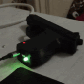

# LedStatus

Неблокирующая библиотека-индикатор состояния для одного RGB-светодиода с общим катодом.
Режимы: постоянный цвет (`NOT_BLINK`), мигание (`BLINK`) и радуга (`RAINBOW`).



## Установка

Arduino IDE → Sketch → Include Library → Add .ZIP Library → выбрать архив.

## Подключение светодиода (общий катод)

Каждый канал — через резистор 330–470 Ом на PWM-пин, общий катод — на GND.
При такой схеме HIGH на канале = светодиод горит, инверсия не нужна.

| Платформа       | Рекомендуемые пины         | Примечание |
|-----------------|----------------------------|------------|
| ESP8266         | любые GPIO                 | ШИМ на всех цифровых пинах |
| ATmega328P      | 9, 10, 11 (Timer1)         | ШИМ только на 3, 5, 6, 9, 10, 11; пин 6 использует Timer0 вместе с `millis()` — возможен лёгкий джиттер |
| ESP32           | любые выводящие GPIO       | Требуется Arduino core 2.x и новее (в 1.x нет `analogWrite`) |

На пинах без ШИМ `analogWrite` вырождается в `digitalWrite`: мигание и постоянный цвет
будут работать, радуга станет ступенчатой.

## Быстрый старт

```cpp
#include <LedStatus.h>

using namespace DenChela;

uint8_t green[3] = {0, 255, 0};
LedStatus led(9, 10, 11);   // R, G, B

void setup() {
    led.setMode(LedStatus::BLINK, green);
}

void loop() {
    led.handle();   // вызывать в каждом витке loop()
}
```

## API

| Метод | Описание |
|-------|----------|
| `LedStatus(r, g, b)` | Конструктор: пины каналов, настраиваются как выходы и гасятся |
| `handle()` | Обновление анимации; вызывать в каждом витке `loop()` |
| `setMode(mode, color[3])` | Режим и цвет; для `RAINBOW` всегда стартует с красного с первой фазы |
| `setMode(mode)` | То же с чёрным цветом |
| `setTimePeriodBlink(ms)` | Полупериод мигания; значения <= 10 мс игнорируются |
| `setTimePeriodRainbow(ms)` | Период шага радуги; значения <= 10 мс игнорируются |
| `setStepRainbow(step)` | Шаг изменения цвета (1–255); 0 игнорируется — иначе радуга замерла бы |

Значения по умолчанию: полупериод мигания 300 мс, период радуги 70 мс, шаг 20.
Настройки хранятся в экземпляре — несколько индикаторов настраиваются независимо.

## Рекомендации

- `handle()` должен вызываться регулярно, в том числе внутри блокирующих циклов
  ожидания (Wi-Fi и т. п.) — иначе анимация замрёт.
- При смене режима отсчёт времени начинается заново: первая фаза мигания
  отсчитывается от вызова `setMode()`.
- `setMode(RAINBOW, color)` игнорирует переданный цвет и стартует с красного —
  это осознанное поведение.

## Примечания по реализации

- Все записи в светодиод идут через единственный приватный метод `setColor()`,
  а массив `position[]` хранит актуальное состояние каналов — «зеркало пинов».
- В режиме радуги запись в каналы идёт напрямую через `analogWrite` (минуя
  `setColor`), потому что за такт меняется один канал. Это задокументированный
  дизайн-выбор ради экономии вызовов; массив `position` обновляется до записи,
  поэтому рассинхронизация исключена. При изменении радуги менять каналы можно
  только из `position`.
- Динамическая память не используется; размер объекта — около 20 байт RAM.

## Лицензия

MIT
